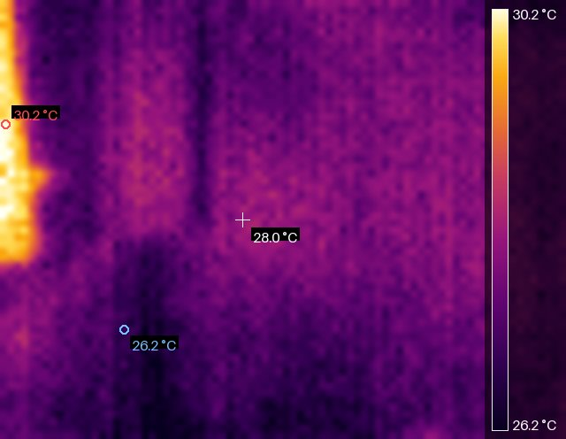
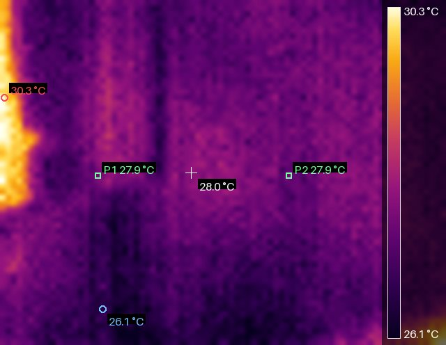

# SenXor 熱影像相機（Home Assistant 整合）

[English](README_EN.md) | **繁體中文**

透過 TCP 連線，將 **Meridian Innovation SenXor** 熱影像模組（80 × 62 紅外線陣列）接入 Home Assistant，可搭配 EVK 網路橋接器或序列埠轉乙太網路轉接器使用。

本專案是原廠 Windows 檢視器（`SenXorEvkViewer_2024.06.06.exe`）的功能移植：通訊協定由逆向工程取得，影像處理流程（調色盤、色階、濾波、校正、讀值）以純 Python 重新實作。



## 安裝

**HACS（建議）**

[](https://my.home-assistant.io/redirect/hacs_repository/?owner=iamafreeride&repository=Thermal_USB_Camera_For_HA&category=integration)

1. HACS → **整合** → ⋮ → **自訂儲存庫**
2. 加入 `https://github.com/iamafreeride/Thermal_USB_Camera_For_HA`，類別選 **Integration**
3. 安裝 **SenXor Thermal Camera** 並重新啟動 Home Assistant
4. **設定 → 裝置與服務 → 新增整合 → SenXor Thermal Camera**
5. 輸入相機位址；設定流程會等待收到一張真實熱影像後才建立項目

**手動安裝：** 將 `custom_components/senxor_thermal` 複製到 `config` 資料夾並重新啟動。

## 設定

| 欄位 | 預設值 | 說明 |
| --- | --- | --- |
| 主機 | – | 相機／TCP 橋接器的 IP 或主機名稱 |
| 連接埠 | `3333` | SenXor 韌體的原始 TCP 連接埠 |
| 名稱 | `Thermal Camera` | 裝置名稱 |

選項（整合卡片上的 ⚙）：更新間隔（秒）與 JPEG 品質。

## 實體

實體 ID 為 ASCII（`slugify()` 會濾除中文字元），顯示名稱為中文。所有實體都在裝置頁面中；更新後若有實體缺漏，請重新載入整合並強制重新整理瀏覽器。

| 實體 ID | 名稱 | 說明 |
| --- | --- | --- |
| `camera.thermal_camera` | 熱影像 | 偽彩色熱影像（80×62），每次更新重新渲染 |
| `sensor.thermal_camera_minimum_temperature` | 最低溫 | 畫面最冷像素 |
| `sensor.thermal_camera_maximum_temperature` | 最高溫 | 畫面最熱像素 |
| `sensor.thermal_camera_average_temperature` | 平均溫 | 全部 4960 像素平均 |
| `sensor.thermal_camera_centre_temperature` | 中心溫 | 十字準星下的像素 |
| `sensor.thermal_camera_temperature_1` / `_2` | 溫度1 / 溫度2 | (X1, Y1) / (X2, Y2) 的溫度 |
| `sensor.thermal_camera_die_temperature` | 晶片溫度 | 感測器晶片溫度（GFRA 標頭） |
| `sensor.thermal_camera_vdd` | 供應電壓 | 感測器供應電壓（GFRA 標頭） |
| `sensor.thermal_camera_frame_rate` | 影格率 | 實測影格率（診斷） |
| `number.thermal_camera_x1` / `_y1` / `_x2` / `_y2` | X1 / Y1 / X2 / Y2 | 探點座標（X 0–79、Y 0–61，原點在左上角） |
| `number.thermal_camera_emissivity` | 放射率 | 1–100 %，暫存器 `0xCA` |
| `number.thermal_camera_temperature_offset` | 溫度補償 | −12.8…12.7 °C，暫存器 `0xCB` |
| `number.thermal_camera_sensitivity` | 靈敏度 | 0.01–2.55，暫存器 `0xC2` |
| `number.thermal_camera_frame_rate_divider` | 影格率除數 | 0–127，暫存器 `0xB4`（0 = 最大 FPS） |
| `number.thermal_camera_percentile` | 極值裁切 | 0–0.2，*移除極值* 開啟時使用 |
| `number.thermal_camera_scale_min` / `_scale_max` | 色階下限 / 上限 | 手動色階範圍 |
| `select.thermal_camera_palette` | 調色盤 | 12 種（`INFERNO`、`HEATED_IRON`…） |
| `select.thermal_camera_temperature_unit` | 影像溫度單位 | `°C` `°F` `K` `dK`（僅影響影像上的數字） |
| `select.thermal_camera_filtering` | 濾波 | `None` / `Low` / `High` |
| `select.thermal_camera_gain` | 增益 | `Auto` `1` `0.5` `0.25`，暫存器 `0xB9` |
| `switch.thermal_camera_streaming` | 連續擷取 | 開始／停止串流（`0xB1` = 3/0） |
| `switch.thermal_camera_auto_range` | 自動色階 | 自動調整色階 |
| `switch.thermal_camera_remove_extreme` | 移除極值 | 裁切設定的百分位 |
| `switch.thermal_camera_show_markers` / `_show_colorbar` | 顯示極值標記 / 色階條 | 繪製冷熱點標記／色階條 |
| `button.thermal_camera_fps_increase` / `_fps_decrease` | FPS 增加 / 減少 | 除數 −1（更快）／+1（更慢） |
| `button.thermal_camera_disconnect` / `_reconnect` | 中斷連線 / 重新連線 | 關閉 TCP 連線／重新連線並重啟串流 |

> 2.1.0 起實體 ID 已變更（`probe_1_x` → `x1`、`probe_1_temperature` → `temperature_1`、`scale_minimum` → `scale_min`、`increase_frame_rate` → `fps_increase` 等）。若儀表板仍依賴舊 ID，請在實體設定中改回。

### 補充說明

- **探點：** 兩個探點會以綠色標記及即時讀值畫在熱影像上。座標會在重啟後保留，超出範圍的值會被限制在邊界。

  

- **影格率：** `0xB4` 是絕對除數：`0` = 最大 FPS，`1…127` = `FPS_MAX / 除數`。測試相機實測：`0` → 14.8 fps、`2` → 8.3 fps、`4` → 4.7 fps。
- **單位：** 感測器一律回報 °C（由 Home Assistant 轉換）；影像單位只影響畫在熱影像上的數字。
- **串流中斷時按下按鈕：** 會先嘗試重新連線，若相機無法連上則回報錯誤。

## 服務 `senxor_thermal.snapshot`

將目前熱影像寫入 `config/www/senxor_thermal/`。

```yaml
service: senxor_thermal.snapshot
data:
  filename: kitchen
  csv: true
```

回傳：`{"image": ".../kitchen.jpg", "csv": ".../kitchen.csv", "min_dk": 2977, "max_dk": 3034}`

## 範例

儀表板：

```yaml
type: vertical-stack
cards:
  - type: picture-entity
    entity: camera.thermal_camera
    camera_view: auto
    show_name: false
  - type: entities
    entities:
      - sensor.thermal_camera_maximum_temperature
      - sensor.thermal_camera_minimum_temperature
      - select.thermal_camera_palette
      - number.thermal_camera_emissivity
      - switch.thermal_camera_auto_range
```

高溫通知：

```yaml
trigger:
  - platform: numeric_state
    entity_id: sensor.thermal_camera_maximum_temperature
    above: 60
action:
  - service: notify.persistent_notification
    data:
      title: 偵測到高溫點
      message: "最高溫：{{ trigger.to_state.state }} °C"
```

## 與原廠檢視器的功能對照

| 檢視器功能 | 狀態 |
| --- | --- |
| TCP/IP 連線 | ✅ 設定流程 |
| USB 連線 | ❌ 未移植（同協定走序列埠） |
| 連線／中斷 | ✅ 設定流程 + 按鈕 |
| 單張／連續擷取 | ✅ 連續擷取開關 |
| FPS 增減 | ✅ 按鈕 + 除數數值 |
| 12 種調色盤 | ✅（重新建立，非逐位元組相同） |
| 自動／手動色階、移除極值 | ✅ 開關 + 數值 |
| 濾波、溫度單位 | ✅ 選單 |
| 放射率、補償、靈敏度、增益 | ✅ 暫存器 `0xCA` / `0xCB` / `0xC2` / `0xB9` |
| 指定像素 (X, Y) 溫度 | ✅ 探點 + 最高溫／中心溫感測器 |
| 晶片資訊（VDD、晶片溫度） | ✅ 取自 GFRA 標頭 |
| 資料記錄 | ✅ `snapshot` 服務（JPEG + CSV） |
| 生命偵測（TensorFlow） | ❌ 不在範圍內 |
| 產品校正 | ❌ 原廠工具 |

## 疑難排解

- **同一時間只能有一個 TCP 連線。** 請先關閉 Windows 檢視器，否則日誌會出現 `connection closed by device`。
- **收不到影像。** 在同一網路的電腦執行 `python tools/probe.py --host <ip>`，會列出訊息流程並產生 `frame.jpg`。
- **除錯日誌：**

  ```yaml
  logger:
    logs:
      custom_components.senxor_thermal: debug
  ```

## 運作原理

純 TCP socket，ASCII 訊框（`#` + 4 位十六進位長度 + 4 字元指令）。以一次 `WREG` 寫入啟動串流，之後每個 10253 位元組的 `GFRA` 訊框包含 4960 個小端序 `uint16` 的 deci-Kelvin 取樣。詳見 [docs/protocol.md](docs/protocol.md)。

## 授權

MIT – 見 [LICENSE](LICENSE)。與 Meridian Innovation Limited 無關聯，亦未獲其背書或支援。「SenXor」為其各自所有者之商標。
