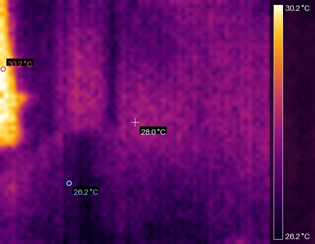
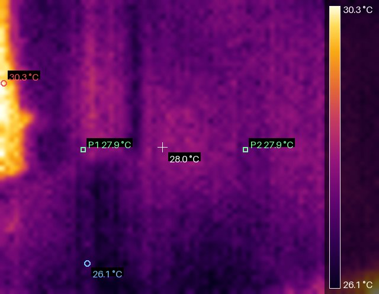

# Thermal USB Camera for Home Assistant

Home Assistant integration for the **Meridian Innovation SenXor** thermal camera
module (80 × 62 IR array) when it is reachable over TCP — for example through the
network bridge that ships with the EVK, or a serial-to-Ethernet adapter.

This project is a functional port of the vendor's Windows application
`SenXorEvkViewer_2024.06.06.exe`. The viewer's USB/TCP protocol was
reverse-engineered from the shipped binary and from live traffic, and the
viewer's imaging pipeline (palettes, colour scale, filtering, calibration,
readouts) was re-implemented in pure Python inside a HACS-installable
integration.

```
camera.thermal_camera        live thermogram, 80x62, 4-16 fps (device divider)
sensor.*                     min / max / average / centre temperature, hot spot, fps
number.*                     emissivity, temperature offset, manual scale limits
select.*                     palette, image unit, spatial filtering
switch.*                     auto range, remove extremes, markers, colour bar
button.*                     single frame, restart stream, frame rate up/down
```



The image above is produced by this integration from a real frame of the
camera (HEATED_IRON palette, automatic range, colour bar,
min/max markers and centre readout — the same overlays the Windows viewer draws).

## Installation

### HACS (recommended)

[](https://my.home-assistant.io/redirect/hacs_repository/?owner=iamafreeride&repository=Thermal_USB_Camera_For_HA&category=integration)

1. HACS → **Integrations** → ⋮ → **Custom repositories**
2. Add `https://github.com/iamafreeride/Thermal_USB_Camera_For_HA` with category **Integration**
3. Install **SenXor Thermal Camera**, then restart Home Assistant
4. **Settings → Devices & Services → Add Integration → SenXor Thermal Camera**
5. Enter the camera address (default port `3333`) and submit — the flow connects
   to the device and waits for one real thermal frame before creating the entry

### Manual

Copy `custom_components/senxor_thermal` into your Home Assistant `config` folder
and restart.

## Configuration

| Field | Default | Description |
| --- | --- | --- |
| Host | – | IP address or host name of the camera / TCP bridge |
| Port | `3333` | Raw TCP port of the SenXor firmware |
| Name | `Thermal Camera` | Device name |

Options (⚙ on the integration card): update interval (seconds) and JPEG quality.

## Entities

All entities use a Chinese display name; the entity id stays ASCII because
Home Assistant's slugify() drops CJK characters.

| Entity id | 名稱 | Description |
| --- | --- | --- |
| `camera.thermal_camera` | 熱影像 | False colour thermogram, re-rendered every update |
| `sensor.thermal_camera_minimum_temperature` | 最低溫 | Coldest pixel of the frame |
| `sensor.thermal_camera_maximum_temperature` | 最高溫 | Hottest pixel of the frame |
| `sensor.thermal_camera_average_temperature` | 平均溫 | Mean of all 4960 pixels |
| `sensor.thermal_camera_centre_temperature` | 中心溫 | Pixel under the crosshair |
| `sensor.thermal_camera_temperature_1` | 溫度1 | Temperature at (X1, Y1) |
| `sensor.thermal_camera_temperature_2` | 溫度2 | Temperature at (X2, Y2) |
| `sensor.thermal_camera_die_temperature` | 晶片溫度 | Sensor die temperature (GFRA header) |
| `sensor.thermal_camera_vdd` | 供應電壓 | Sensor supply voltage (GFRA header) |
| `sensor.thermal_camera_frame_rate` | 影格率 | Measured frame rate (diagnostic) |
| `number.thermal_camera_x1` | X1 | Probe 1 X (0–79) |
| `number.thermal_camera_y1` | Y1 | Probe 1 Y (0–61) |
| `number.thermal_camera_x2` | X2 | Probe 2 X (0–79) |
| `number.thermal_camera_y2` | Y2 | Probe 2 Y (0–61) |
| `number.thermal_camera_emissivity` | 放射率 | 1–100 %, register `0xCA` |
| `number.thermal_camera_temperature_offset` | 溫度補償 | −12.8…12.7 °C, register `0xCB` |
| `number.thermal_camera_sensitivity` | 靈敏度 | 0.01–2.55, register `0xC2` |
| `number.thermal_camera_frame_rate_divider` | 影格率除數 | 0–127, register `0xB4` (0 = maximum FPS) |
| `number.thermal_camera_percentile` | 極值裁切 | 0–0.2, used when *移除極值* is on |
| `number.thermal_camera_scale_min` / `_max` | 色階下限 / 色階上限 | Manual colour scale limits |
| `select.thermal_camera_palette` | 調色盤 | 12 palettes (`INFERNO`, `HEATED_IRON`, …) |
| `select.thermal_camera_temperature_unit` | 影像溫度單位 | `°C` `°F` `K` `dK` on the image |
| `select.thermal_camera_filtering` | 濾波 | `None` / `Low` / `High` |
| `select.thermal_camera_gain` | 增益 | `Auto` `1` `0.5` `0.25`, register `0xB9` |
| `switch.thermal_camera_streaming` | 連續擷取 | Start/stop streaming (`0xB1` = 3/0) |
| `switch.thermal_camera_auto_range` | 自動色階 | Automatic colour scale |
| `switch.thermal_camera_remove_extreme` | 移除極值 | Trim the configured percentile |
| `switch.thermal_camera_show_markers` | 顯示極值標記 | Draw hot/cold markers |
| `switch.thermal_camera_show_colorbar` | 顯示色階條 | Draw the colour bar |
| `button.thermal_camera_fps_increase` | FPS 增加 | Divider − 1 (faster) |
| `button.thermal_camera_fps_decrease` | FPS 減少 | Divider + 1 (slower) |
| `button.thermal_camera_disconnect` | 中斷連線 | Close the TCP connection |
| `button.thermal_camera_reconnect` | 重新連線 | Reconnect and restart streaming |

### Where to look

Everything is visible on the device page (**設定 → 裝置與服務 → SenXor → 實體**);
no entity is hidden in a collapsed category.  If an entity is still missing after
an update, reload the integration once (⚙ → 重新載入) so the new platforms are
registered, then hard-refresh the browser.

The four buttons are 中斷連線 / 重新連線 / FPS 增加 / FPS 減少; the four number
boxes are X1 / Y1 / X2 / Y2; the two probe temperatures are 溫度1 / 溫度2.

> Entity ids changed in 2.1.0 (`probe_1_x` → `x1`, `probe_1_temperature` →
> `temperature_1`, `scale_minimum` → `scale_min`, `increase_frame_rate` →
> `fps_increase`, …).  Rename them back in the entity settings if a dashboard
> depends on the old ids.

### Probe coordinates

Two free probes address single pixels: set `number.thermal_camera_probe_1_x` /
`_1_y` (and the same for probe 2) to a coordinate between `0..79` and `0..61`
(origin is the top-left corner of the image). The matching
`sensor.thermal_camera_probe_1_temperature` / `_2_temperature` report the
calibrated temperature of exactly that pixel, and both probes are drawn onto the
thermogram as green markers with their live reading:



The coordinates are stored in the config entry and survive restarts; values are
clamped to the sensor area, so an out-of-range coordinate simply pins to the
border.

All buttons stay pressable even while the stream is down: pressing one first
tries to re-establish the connection, and reports a clear error if the camera is
unreachable (for example because the Windows viewer holds the stream).

### Frame rate divider

`0xB4` is an absolute divider, not an up/down command: `0` selects the maximum
frame rate and `1…127` select `FPS_MAX / divider`. The two buttons step the
divider by one and the `Frame rate divider` number lets you jump directly.
Measured on the test camera: divider `0` → 14.8 fps, `2` → 8.3 fps, `4` → 4.7 fps.

Sensors always report **°C**; Home Assistant converts them to your unit system.
The *image temperature unit* only affects the numbers drawn on the thermogram,
matching the vendor viewer's "Temperature Unit" radio buttons.

### Service `senxor_thermal.snapshot`

Writes the current thermogram to `config/www/senxor_thermal/`.

```yaml
service: senxor_thermal.snapshot
data:
  filename: kitchen
  csv: true
```

Response: `{"image": ".../kitchen.jpg", "csv": ".../kitchen.csv", "min_dk": 2977, "max_dk": 3034}`

## Example dashboard

```yaml
type: vertical-stack
cards:
  - type: picture-entity
    entity: camera.thermal_camera
    camera_view: auto
    show_name: false
  - type: entities
    entities:
      - sensor.thermal_camera_maximum_temperature
      - sensor.thermal_camera_minimum_temperature
      - select.thermal_camera_palette
      - number.thermal_camera_emissivity
      - switch.thermal_camera_automatic_temperature_range
```

Automation example – notify on a hot spot:

```yaml
trigger:
  - platform: numeric_state
    entity_id: sensor.thermal_camera_maximum_temperature
    above: 60
action:
  - service: notify.persistent_notification
    data:
      title: Hot spot detected
      message: >-
        {{ trigger.to_state.state }} °C at
        ({{ state_attr('sensor.thermal_camera_hotspot_x','x') }}, ...)
```

## Feature parity with the vendor viewer

| Viewer feature | Status here |
| --- | --- |
| TCP/IP connection (host:port) | ✅ config flow |
| USB connection | ❌ (same protocol over a serial port; not ported, HA hosts are usually remote) |
| Connect / Disconnect | ✅ integration setup + *Restart stream* button |
| Single frame / continuous stream | ✅ buttons + always-on stream |
| FPS up / down | ✅ buttons + divider number (`0xB4`, 0 = maximum FPS) |
| 12 colour palettes | ✅ select (tables recreated, not byte-identical) |
| Auto / manual temperature range, remove extremes | ✅ switches + numbers |
| Filtering none / low / high | ✅ select |
| Temperature unit °C/°F/K/dK | ✅ select (image overlay) |
| Emissivity, temperature offset, sensitivity | ✅ numbers written to registers `0xCA` / `0xCB` / `0xC2` |
| Sensitivity / gain controls | ✅ `number.sensitivity` (`0xC2`) and `select.gain` (`0xB9`) |
| Temperature at pixel (X, Y) | ✅ hotspot/centre sensors + camera attributes |
| Die info (VDD, die temperature) | ✅ decoded from the GFRA header (`sensor.vdd`, `sensor.die_temperature`) |
| Data recording to text files | ✅ `senxor_thermal.snapshot` (JPEG + CSV) |
| Life detection (TensorFlow model) | ❌ out of scope (ships `DnIRB_v2_2_thermal_sigma25_depth5.pb`, no portable equivalent) |
| Product calibration | ❌ factory tool, not ported |

## Verified against

* Camera `192.168.11.153:3333` (SenXor firmware answer: `#0008WREG01FD` to a
  stream-start write), host `192.168.11.11`
* `SenXorEvkViewer 2024.06.06.0`, file version `2024.06.06.0`, 23 278 592 bytes

## Troubleshooting

* **Only one TCP client at a time.** The firmware accepts a single connection;
  quit the Windows viewer before using Home Assistant (the integration logs
  `connection closed by device` otherwise).
* **No frames.** Run `python tools/probe.py --host <ip>` on a machine in the same
  network. It prints the message flow and writes `frame.jpg`.
* Enable debug logging:

  ```yaml
  logger:
    logs:
      custom_components.senxor_thermal: debug
  ```

## How it works

The protocol is documented in [docs/protocol.md](docs/protocol.md). In short: a
plain TCP socket, ASCII framed messages (`#` + 4 hex length + 4 char command),
one `WREG` register write to start streaming and then 10253 byte `GFRA` frames
containing 4960 little-endian `uint16` deci-Kelvin samples.

## 繁體中文快速說明

1. HACS → 整合 → 右上角 ⋮ → 自訂儲存庫，貼上本專案網址，類別選「Integration」。
2. 安裝 **SenXor Thermal Camera** 後重新啟動 Home Assistant。
3. 設定 → 裝置與服務 → 新增整合 → 搜尋 `SenXor` → 輸入 `IP`、連接埠 `3333`。
4. 相機會出現在 `camera.thermal_camera`，並附上最高/最低/平均/中心溫度感測器、色彩盤、
   濾波、放射率與色階控制。
5. 注意：原廠 Windows 檢視器同一時間只能有一個連線，使用前請先關閉。

## License

MIT – see [LICENSE](LICENSE). Not affiliated with, endorsed by, or supported by
Meridian Innovation Limited. "SenXor" is a trademark of its respective owner.
