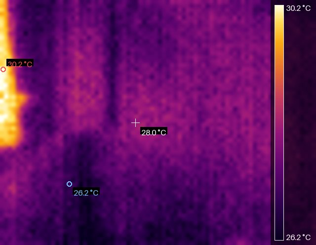
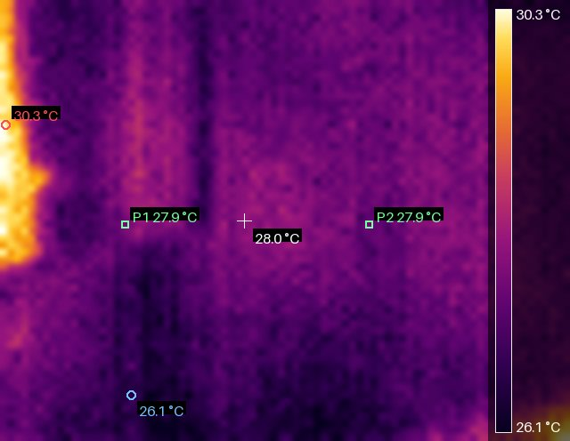

# SenXor Thermal Camera for Home Assistant

**English** | [繁體中文](README.zh-TW.md)

Home Assistant integration for the **Meridian Innovation SenXor** thermal camera module (80 × 62 IR array) over TCP, e.g. through the EVK network bridge or a serial-to-Ethernet adapter.

It is a functional port of the vendor's Windows viewer (`SenXorEvkViewer_2024.06.06.exe`): the TCP protocol was reverse-engineered, and the imaging pipeline (palettes, colour scale, filtering, calibration, readouts) is re-implemented in pure Python.



## Installation

**HACS (recommended)**

[](https://my.home-assistant.io/redirect/hacs_repository/?owner=iamafreeride&repository=Thermal_USB_Camera_For_HA&category=integration)

1. HACS → **Integrations** → ⋮ → **Custom repositories**
2. Add `https://github.com/iamafreeride/Thermal_USB_Camera_For_HA`, category **Integration**
3. Install **SenXor Thermal Camera** and restart Home Assistant
4. **Settings → Devices & Services → Add Integration → SenXor Thermal Camera**
5. Enter the camera address; the flow waits for one real thermal frame before creating the entry

**Manual:** copy `custom_components/senxor_thermal` into your `config` folder and restart.

## Configuration

| Field | Default | Description |
| --- | --- | --- |
| Host | – | IP address or host name of the camera / TCP bridge |
| Port | `3333` | Raw TCP port of the SenXor firmware |
| Name | `Thermal Camera` | Device name |

Options (⚙ on the integration card): update interval (seconds) and JPEG quality.

## Entities

Entity ids are ASCII (`slugify()` drops CJK characters). Everything appears on the device page. If an entity is missing after an update, reload the integration and hard-refresh the browser.

| Entity id | Description |
| --- | --- |
| `camera.thermal_camera` | False-colour thermogram, 80×62, re-rendered every update |
| `sensor.thermal_camera_minimum_temperature` / `_maximum_` / `_average_` / `_centre_temperature` | Coldest, hottest, mean (4960 px) and crosshair pixel |
| `sensor.thermal_camera_temperature_1` / `_2` | Temperature at probe pixel (X1, Y1) / (X2, Y2) |
| `sensor.thermal_camera_die_temperature`, `_vdd` | Die temperature and supply voltage (GFRA header) |
| `sensor.thermal_camera_frame_rate` | Measured frame rate (diagnostic) |
| `number.thermal_camera_x1` / `_y1` / `_x2` / `_y2` | Probe coordinates (X 0–79, Y 0–61, origin top-left) |
| `number.thermal_camera_emissivity` | 1–100 %, register `0xCA` |
| `number.thermal_camera_temperature_offset` | −12.8…12.7 °C, register `0xCB` |
| `number.thermal_camera_sensitivity` | 0.01–2.55, register `0xC2` |
| `number.thermal_camera_frame_rate_divider` | 0–127, register `0xB4` (0 = max FPS) |
| `number.thermal_camera_percentile` | 0–0.2, used when *remove extremes* is on |
| `number.thermal_camera_scale_min` / `_scale_max` | Manual colour scale limits |
| `select.thermal_camera_palette` | 12 palettes (`INFERNO`, `HEATED_IRON`, …) |
| `select.thermal_camera_temperature_unit` | `°C` `°F` `K` `dK` (image overlay only) |
| `select.thermal_camera_filtering` | `None` / `Low` / `High` |
| `select.thermal_camera_gain` | `Auto` `1` `0.5` `0.25`, register `0xB9` |
| `switch.thermal_camera_streaming` | Start/stop streaming (`0xB1` = 3/0) |
| `switch.thermal_camera_auto_range` | Automatic colour scale |
| `switch.thermal_camera_remove_extreme` | Trim the configured percentile |
| `switch.thermal_camera_show_markers` / `_show_colorbar` | Draw hot/cold markers / colour bar |
| `button.thermal_camera_fps_increase` / `_fps_decrease` | Divider −1 (faster) / +1 (slower) |
| `button.thermal_camera_disconnect` / `_reconnect` | Close the TCP connection / reconnect and restart streaming |

> Entity ids changed in 2.1.0 (`probe_1_x` → `x1`, `probe_1_temperature` → `temperature_1`, `scale_minimum` → `scale_min`, `increase_frame_rate` → `fps_increase`, …). Rename them back in the entity settings if a dashboard depends on the old ids.

### Notes

- **Probes:** both probes are drawn on the thermogram as green markers with their live reading. Coordinates persist across restarts and out-of-range values are clamped to the border.

  

- **Frame rate:** `0xB4` is an absolute divider: `0` = max FPS, `1…127` = `FPS_MAX / divider`. Measured on the test camera: `0` → 14.8 fps, `2` → 8.3 fps, `4` → 4.7 fps.
- **Units:** sensors always report °C (Home Assistant converts them); the image unit only affects numbers drawn on the thermogram.
- **Buttons while the stream is down:** pressing one first tries to reconnect, and reports an error if the camera is unreachable.

## Service `senxor_thermal.snapshot`

Writes the current thermogram to `config/www/senxor_thermal/`.

```yaml
service: senxor_thermal.snapshot
data:
  filename: kitchen
  csv: true
```

Response: `{"image": ".../kitchen.jpg", "csv": ".../kitchen.csv", "min_dk": 2977, "max_dk": 3034}`

## Examples

Dashboard:

```yaml
type: vertical-stack
cards:
  - type: picture-entity
    entity: camera.thermal_camera
    camera_view: auto
    show_name: false
  - type: entities
    entities:
      - sensor.thermal_camera_maximum_temperature
      - sensor.thermal_camera_minimum_temperature
      - select.thermal_camera_palette
      - number.thermal_camera_emissivity
      - switch.thermal_camera_auto_range
```

Hot-spot notification:

```yaml
trigger:
  - platform: numeric_state
    entity_id: sensor.thermal_camera_maximum_temperature
    above: 60
action:
  - service: notify.persistent_notification
    data:
      title: Hot spot detected
      message: "Maximum temperature: {{ trigger.to_state.state }} °C"
```

## Feature parity with the vendor viewer

| Viewer feature | Status |
| --- | --- |
| TCP/IP connection | ✅ config flow |
| USB connection | ❌ not ported (same protocol over serial) |
| Connect / disconnect | ✅ setup + buttons |
| Single frame / continuous stream | ✅ streaming switch |
| FPS up / down | ✅ buttons + divider number |
| 12 palettes | ✅ (recreated, not byte-identical) |
| Auto / manual range, remove extremes | ✅ switches + numbers |
| Filtering, temperature unit | ✅ selects |
| Emissivity, offset, sensitivity, gain | ✅ registers `0xCA` / `0xCB` / `0xC2` / `0xB9` |
| Temperature at pixel (X, Y) | ✅ probes + hot spot/centre sensors |
| Die info (VDD, die temperature) | ✅ from GFRA header |
| Data recording | ✅ `snapshot` service (JPEG + CSV) |
| Life detection (TensorFlow) | ❌ out of scope |
| Product calibration | ❌ factory tool |

## Troubleshooting

- **Only one TCP client at a time.** Quit the Windows viewer first, otherwise the log shows `connection closed by device`.
- **No frames.** Run `python tools/probe.py --host <ip>` on a machine in the same network; it prints the message flow and writes `frame.jpg`.
- **Debug logging:**

  ```yaml
  logger:
    logs:
      custom_components.senxor_thermal: debug
  ```

## How it works

Plain TCP socket with ASCII-framed messages (`#` + 4 hex length + 4-char command). One `WREG` write starts streaming; then 10253-byte `GFRA` frames carry 4960 little-endian `uint16` deci-Kelvin samples. See [docs/protocol.md](docs/protocol.md).

## License

MIT – see [LICENSE](LICENSE). Not affiliated with, endorsed by, or supported by Meridian Innovation Limited. "SenXor" is a trademark of its respective owner.
